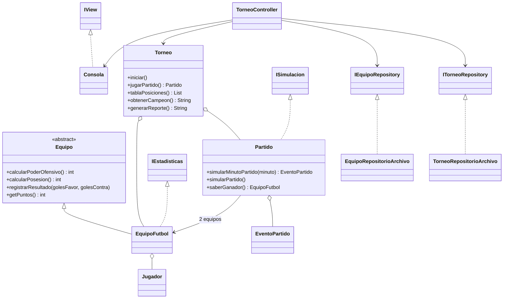

# Simulador de torneo de fútbol

Aplicación de consola en **Java 21** que organiza un torneo todos contra todos y simula cada partido minuto a minuto. Lleva la tabla de posiciones, los goleadores y el campeón, y guarda equipos, torneos y reportes en archivos.

Proyecto final de Desarrollo 2, Ingeniería de Sistemas, Universidad El Bosque. Sigue el patrón **MVC** (`model`, `view`, `controller`) con una capa de archivos aparte (`files`).

## Funcionalidades

- **Equipos**: nombre, formación (por ejemplo `4-3-3`), poder ofensivo, posesión y plantilla opcional de jugadores. Se guardan en `datos/equipos.csv` y hay 6 equipos de ejemplo para empezar rápido.
- **Calendario todos contra todos** armado con el método del círculo: en cada fecha cada equipo juega una vez (con un número impar de equipos, uno descansa) y cada par de equipos se enfrenta una sola vez.
- **Simulación minuto a minuto** de los 90 minutos, con ocasiones, goles y quién los anota.
- **Tabla de posiciones** con PJ, PG, PE, PP, GF, GC, DG y puntos, ordenada por puntos, diferencia de gol, goles a favor y nombre.
- **Reporte del torneo** en `.txt` con tabla, resultados, goleadores y campeón.
- **Guardar y cargar torneos** a mitad de camino (serialización de Java).
- Validación de todas las entradas: el menú vuelve a preguntar si el dato no sirve, sin cerrarse.

## Cómo se simula un partido

En cada minuto:

1. **Quién tiene el balón.** Se sortea con la posesión de cada equipo: `posesión base + 5 × mediocampistas`.
2. **Si hay ocasión de gol.** El equipo con el balón genera una ocasión con probabilidad `poder ofensivo / 900`, donde `poder ofensivo = base + 5 × delanteros`.
3. **Si la ocasión es gol.** 30 % de las ocasiones terminan en gol. Si el equipo tiene plantilla, remata un delantero (o un mediocampista si no hay delanteros).

Con los equipos de ejemplo salen unos 2,3 goles por partido en promedio y cerca del 9 % de los partidos terminan 0-0 (medido con 2.000 partidos simulados). La formación sí importa: un `4-2-4` ataca más y un `4-5-1` tiene más el balón.

## Ejemplo

Salida real del programa (opciones 3, 4, 5 y 6 del menú):

```text
Leones FC vs Atlético Bosque
   6' Ocasión de Leones FC: Andrés Rincón remata y no entra.
  28' Ocasión de Leones FC: Andrés Rincón remata y no entra.
  49' Ocasión de Atlético Bosque: Daniel Cárdenas remata y no entra.
  65' ¡Gol de Atlético Bosque! Anota Daniel Cárdenas.
  66' Ocasión de Leones FC: Andrés Rincón remata y no entra.
Reporte Del Partido: Leones FC 0 - 1 Atlético Bosque · ocasiones de gol 3 - 2

Pos Equipo                  PJ  PG  PE  PP  GF  GC   DG  Pts
1   Deportivo Sabana         5   2   3   0   6   3    3    9
2   Real Andino              5   2   2   1   4   4    0    8
3   Halcones del Norte       5   2   1   2   4   9   -5    7
4   Atlético Bosque          5   1   3   1   3   3    0    6
5   Unión Caribe             5   1   3   1   3   3    0    6
6   Leones FC                5   1   0   4   7   5    2    3
Terminó el torneo. CAMPEÓN: Deportivo Sabana
```

Cada ejecución da resultados distintos; las pruebas usan una semilla fija para que el resultado sea siempre el mismo.

## Requisitos

- JDK 21 o superior (`java -version`)
- No hace falta instalar Maven: el repositorio trae el *wrapper* (`mvnw`)

## Ejecución

```bash
git clone https://github.com/P2X4A/Proyecto-Final-Desarollo-2.git
cd Proyecto-Final-Desarollo-2
./mvnw package            # Windows: mvnw.cmd package
java -jar target/torneo-futbol.jar
```

Menú principal:

```text
1. Registrar equipo
2. Ver equipos registrados
3. Agregar equipos de ejemplo
4. Crear torneo con los equipos registrados
5. Jugar el siguiente partido
6. Jugar todos los partidos pendientes
7. Ver tabla de posiciones
8. Exportar reporte del torneo (.txt)
9. Guardar o cargar torneos
0. Salir
```

Los archivos se crean en la carpeta `datos/`, junto a donde ejecutes el programa:

| Archivo | Contenido |
| --- | --- |
| `datos/equipos.csv` | Equipos registrados, uno por línea |
| `datos/torneos/*.dat` | Torneos guardados para seguir después |
| `datos/reportes/*.txt` | Reportes exportados |

## Pruebas

```bash
./mvnw test
```

Hay 31 pruebas con JUnit 5. Cubren las estadísticas y la validación de los equipos, la simulación con semilla fija (los goles cuadran con los eventos y con la tabla), el calendario (cada cruce una sola vez, con 2 a 6 equipos), el orden de la tabla, guardar y cargar en una carpeta temporal y un recorrido completo del menú con entradas simuladas.

## Diseño



```text
src/main/java/co/edu/unbosque/
├── controller/   AplMain, TorneoController y los equipos de ejemplo
├── model/        Equipo, EquipoFutbol, Jugador, Partido, EventoPartido, Torneo, enums e interfaces
├── view/         Consola (menús y lectura validada)
├── files/        FileManager y repositorios de equipos (CSV) y torneos (serialización)
├── interfaces/   IView
└── constants/    Rutas de archivos y límites
```

## Historia del proyecto

La entrega del semestre (mayo de 2026) quedó con el modelo a medias. En noviembre de 2026 se terminó: simulación, torneo, persistencia, menú, pruebas y paso a Maven. El historial de commits conserva las dos etapas.

## Autor

Sergio Parra · [github.com/P2X4A](https://github.com/P2X4A)
